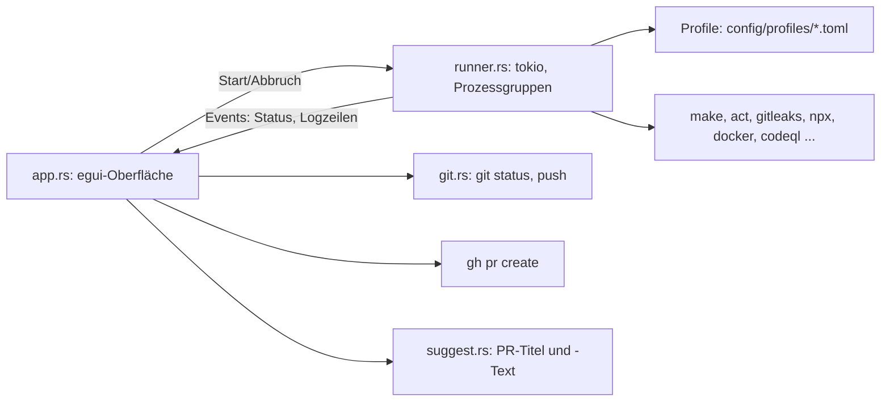

# cubi-precheck

Desktop-App, die vor dem `git push` die CI-Checks eines Repos lokal ausführt. Wenn alle Pflicht-Checks grün sind, kann man per Button pushen oder einen PR öffnen. Die App liegt im cubi-Repo unter [`cubi-precheck/`](https://github.com/pkr-lab/cubi/tree/main/cubi-precheck). Sie ist in Rust geschrieben, die Oberfläche nutzt egui/eframe.

---

## Zweck

Die CI von capulus-core, capulus-ansible und capulus-ios läuft erst nach dem Push. Rote Checks heißen dann: ein weiterer Fix-Commit und ein weiterer CI-Lauf. cubi-precheck führt dieselben Checks vorher lokal aus und gibt den Push erst frei, wenn alle Pflicht-Checks grün sind.

- Pro Repo gibt es ein Profil (TOML) mit genau den Checks, die dessen CI bei einem Pull Request auf `main` ausführt.
- Die Checks laufen asynchron und parallel. Jeder Check hat ein eigenes Live-Log, einen Status, eine Laufzeit, und es gibt einen Abbruch-Button.
- Push und PR passieren nur auf Klick. Push auf `main` ist gesperrt.

---

## Architektur



| Datei (`cubi-precheck/src/`) | Aufgabe |
|---|---|
| `config.rs` | `config.toml` und Profile laden und prüfen (unbekannte Felder und Platzhalter werden abgelehnt) |
| `runner.rs` | Voraussetzungen prüfen, Pfadfilter, Prozesse ohne Shell starten, Logs streamen, Abbruch, Zeitlimit, Push-Gate |
| `git.rs` | Repo-Status, merge-base, geänderte Dateien, Branch anlegen, Push, `gh pr create` |
| `suggest.rs` | Vorschläge für PR-Titel (Conventional Commits, Scope = Projekt), PR-Beschreibung und Branch-Namen |
| `app.rs` | Oberfläche |
| `cli.rs` | `--cli`: dieselben Checks ohne Oberfläche |

**Warum egui und nicht Tauri:** egui ist reines Rust, ohne JS-Frontend und ohne WebView-Dev-Pakete. Logs aus den tokio-Kanälen werden im Immediate-Mode direkt neu gezeichnet. Tauri lohnt sich erst bei einer aufwendigen Web-Oberfläche.

Externe Programme laufen über `tokio::process::Command` mit Argumentlisten, nie als Shell-String. Jeder Check läuft in einer eigenen Prozessgruppe. Beim Abbruch bekommt die Gruppe erst SIGTERM und nach 5 Sekunden SIGKILL. So werden auch Kindprozesse von `act` und `docker` beendet.

---

## Installation

```bash
cd ~/git/github/tools/cubi/cubi-precheck
cargo build --release
mkdir -p ~/.config/cubi-precheck
cp -r config/* ~/.config/cubi-precheck/
```

| Voraussetzung | Wofür |
|---|---|
| Rust stable (`rustup`) | Build |
| `git`, `gh` (angemeldet mit `gh auth login`) | Status, Push, PR |
| Docker (Daemon läuft), [`act`](https://github.com/nektos/act) | Workflow-Jobs mit Inline-Skript (capulus-core) und `docker build` |
| `yamllint`, `helm`, `ansible-lint`, `gitleaks`, `npx`, `python3` mit PyYAML | Checks der Profile |
| `codeql` | optionale CodeQL-Checks |
| macOS mit `xcodegen` und Xcode | Build von capulus-ios |

Fehlende Programme meldet die App pro Check als „Voraussetzung fehlt“. Sie installiert nichts selbst.

---

## Nutzung

```bash
cubi-precheck ~/git/github/capulus/capulus-core    # Oberfläche
cubi-precheck --cli .                               # ohne Oberfläche, Exit-Code 0 = Pflicht-Checks grün
```

1. Repo wählen: aus der Liste in `config.toml`, als Pfad eingeben, oder die App im Repo starten. Oben stehen Remote, Profil, Branch, HEAD, Abstand zum Upstream, geänderte Dateien, Commits seit der Basis und der `gh`-Status.
2. **Alle Checks starten** oder einen einzelnen Check mit ▶ starten. Vorher holt die App `origin/<base_branch>` und bestimmt die merge-base. Gegen sie laufen Pfadfilter, gitleaks und commitlint.
3. Links stehen Status und Laufzeit, rechts das Live-Log des gewählten Checks. **Abbrechen** beendet alle laufenden Checks.
4. **Push** (`git push --set-upstream origin <branch>`) ist nur aktiv, wenn
   - alle Pflicht-Checks `ok` oder per Pfadfilter übersprungen sind,
   - sich HEAD und Arbeitsverzeichnis seit dem Lauf nicht geändert haben,
   - es keine nicht committeten Änderungen gibt.
5. **Push trotzdem …** öffnet einen Dialog mit allen offenen Bedingungen. Der Push geht erst, wenn man dort ausdrücklich bestätigt. Der Override wird im Aktionslog vermerkt.
6. **PR erstellen** (`gh pr create`) geht, sobald der Branch gepusht ist. Der Titel wird im Conventional-Commits-Format vorgeschlagen, mit dem Projekt als Scope. Die Beschreibung listet die Commits und das Ergebnis der lokalen Checks. Beides lässt sich vorher bearbeiten. Existiert schon ein PR, zeigt die App den Link.

Steht das Repo auf `main` (allgemein: auf einem Branch aus `protected_branches`), ist der Push gesperrt. Die App schlägt dann einen Branch-Namen vor (`<typ>/<slug>` aus dem letzten Commit) und legt ihn per `git switch -c` an.

### Status

| Status | Bedeutung | Gibt Push frei |
|---|---|---|
| ok | alle Schritte mit Exit-Code 0 | ja |
| übersprungen | Pfadfilter wie in der CI, oder keine Commits gegenüber der Basis | ja |
| fehlgeschlagen | Exit-Code ≠ 0 oder Zeitlimit überschritten | nein |
| Voraussetzung fehlt | Tool fehlt, Docker läuft nicht, falsches Betriebssystem, Probe fehlgeschlagen | nein |
| abgebrochen | per Button abgebrochen | nein |
| wartet / läuft | noch nicht fertig | nein |

Optionale Checks (`required = false`, kursiv dargestellt) sperren den Push nie.

---

## Konfiguration

Ordner: `~/.config/cubi-precheck/` (oder `--config <ordner>` oder `CUBI_PRECHECK_CONFIG`).

| Datei | Inhalt |
|---|---|
| `config.toml` | `parallel` (gleichzeitige Checks, Standard 2), `repos` (Liste für die Auswahl, `~` erlaubt) |
| `profiles/<name>.toml` | ein Profil pro Repo. Es wird über `remote = "owner/repo"` dem Remote `origin` zugeordnet. |
| `shared/commitlint.config.cjs` | commitlint-Regeln aus `pkr-lab/.github` (v1.2.0) |

### Profil

| Schlüssel | Standard | Bedeutung |
|---|---|---|
| `name` | – | Projektname, auch der Scope im PR-Titel |
| `remote` | – | `owner/repo` |
| `base_branch` | `main` | Ziel-Branch für merge-base und PR |
| `protected_branches` | `["main"]` | Push gesperrt |
| `[[checks]]` | – | Liste der Checks |

### Check

| Schlüssel | Standard | Bedeutung |
|---|---|---|
| `id`, `name` | – | eindeutige ID (`a-z0-9-_:.`), Anzeigename |
| `source` | leer | Herkunft in der CI, z. B. `.github/workflows/ci.yml#lint` |
| `required` | `true` | Pflicht-Check |
| `steps` | – | Liste von Argumentlisten, laufen nacheinander im Repo, ohne Shell |
| `needs` | `[]` | Programme im `PATH` |
| `needs_docker` | `false` | `docker info` muss funktionieren |
| `os` | alle | `linux`, `macos`, `windows` |
| `probes` | `[]` | `{ cmd = [...], hint = "..." }`. Schlägt die Probe fehl, wird `hint` als fehlende Voraussetzung angezeigt. |
| `paths` | alle | Globs. Läuft nur, wenn eine geänderte Datei passt. |
| `paths_ignore` | keine | Globs. Wird übersprungen, wenn alle Änderungen passen. |
| `skip_if_no_commits` | `false` | überspringen, wenn HEAD gleich der merge-base ist |
| `env` | `{}` | zusätzliche Umgebungsvariablen |
| `timeout_secs` | `3600` | Zeitlimit für den ganzen Check |

Platzhalter in Argumenten (nicht im Programmnamen): `{repo}`, `{base}`, `{head}`, `{tmp}`, `{config_dir}`. „Geänderte Dateien“ sind `base..HEAD`, plus nicht committete und unversionierte Dateien.

Neues Repo: Profil anlegen, Pfad in `config.toml` eintragen, fertig. Code ändert sich dafür nicht.

---

## Mitgelieferte Profile

Abgeleitet aus den Workflows, die bei `pull_request` auf `main` laufen. Nicht übernommen sind Workflows, die nur auf `main`, nach Zeitplan oder per Hand laufen: `release`, `mirror-gitlab`, `renovate`, `promote-*`, `sync-entw`, `entw-trigger`, `token-watch`, `security-issues`, `tailscale-poc` und `image-scan`.

### capulus-core

| Check | CI-Job | Lokal | Pflicht |
|---|---|---|---|
| `lint` | `ci.yml#lint` | `make lint`. Braucht `helm`, denn das Makefile überspringt `helm lint` sonst stillschweigend. | ja |
| `manifest-validate` | `ci.yml#manifest-validate` | `act -j manifest-validate` | ja |
| `go-check` | `ci.yml#go-check` | `act -j go-check` | ja |
| `isc-news-bot` | `ci.yml#isc-news-bot` | `act -j isc-news-bot` | ja |
| `token-register` | `ci.yml#token-register` | `python3 scripts/check-token-register.py` | ja |
| `secret-scan` | `ci.yml#secret-scan` | `gitleaks git` über `base..HEAD` mit `.gitleaks.toml` und `.gitleaksignore` | ja |
| `commitlint` | `commitlint.yml` | `npx @commitlint/cli` über `base..HEAD` | ja |
| `build-<app>` (6×) | `build-images.yml#build` | `docker build` ohne Push, nur bei Änderungen unter dem App-Pfad | ja |
| `codeql-<sprache>` (4×) | `codeql.yml` | `codeql database create/analyze`, Ergebnis als CSV im Log | nein |

### capulus-ansible

| Check | CI-Job | Lokal | Pflicht |
|---|---|---|---|
| `lint` | `ci.yml#lint` | `ansible-galaxy collection install -r requirements.yml`, dann `make lint` | ja |
| `ca-checksum` | `ci.yml#ca-checksum` | Root-CA von capulus-core `main` per `curl`, dann `cmp` | ja |
| `secret-scan` | `ci.yml#secret-scan` | `gitleaks git` | ja |
| `commitlint` | `commitlint.yml` | `npx @commitlint/cli` | ja |

### capulus-ios

| Check | CI-Job | Lokal | Pflicht |
|---|---|---|---|
| `build` | `ci.yml#build` | `xcodegen generate`, dann `xcodebuild build`. Nur auf macOS. | ja |
| `ca-checksum` | `ci.yml#ca-checksum` | wie bei capulus-ansible, mit `Resources/homeserver-root-ca.pem` | ja |
| `secret-scan` | `ci.yml#secret-scan` | `gitleaks git` | ja |
| `commitlint` | `commitlint.yml` | `npx @commitlint/cli` | ja |
| `codeql-actions`, `codeql-swift` | `codeql.yml` | CodeQL, Swift nur auf macOS | nein |

**Warum diese Ausführungsart:**

- Jobs mit Inline-Skript im Workflow laufen über `act`. So wird nichts nachgebaut und eine Änderung am Workflow wirkt sofort. `act` nutzt das Image `catthehacker/ubuntu:act-latest`.
- `gitleaks-action` braucht unter `act` ein Token und für Organisationen eine Lizenz. Darum ruft die App das gitleaks-Programm direkt auf, mit derselben Konfiguration.

**Unterschiede zur CI:**

- Lokal wird das Arbeitsverzeichnis geprüft, nicht der Merge-Commit des PRs.
- Das Push-Gate verlangt deshalb ein sauberes Arbeitsverzeichnis.

---

## Debugging und Fehlersuche

| Meldung | Ursache | Lösung |
|---|---|---|
| `Konfiguration: Profilordner … fehlt` | Konfiguration nicht kopiert | `cp -r config/* ~/.config/cubi-precheck/` |
| `Kein Profil für owner/repo` | kein Profil mit passendem `remote` | Profil anlegen |
| `Tool nicht installiert: …` | Programm fehlt im `PATH` | installieren und den Check neu starten |
| `Docker läuft nicht …` | `docker info` schlägt fehl | Docker starten, Benutzer in der Gruppe `docker` |
| `benötigt Betriebssystem macos` | iOS-Build unter Linux | auf dem Mac ausführen oder per Override pushen |
| `Warnung: git fetch fehlgeschlagen …` | offline | Die App nutzt den lokalen Stand von `origin/<base>`. |
| `Stand hat sich seit dem Lauf geändert` | Commit oder Änderung nach dem Lauf | Checks neu starten |
| `gh ist nicht angemeldet` | kein gh-Login | `gh auth login` |
| act fragt nach einem Image oder hängt beim ersten Lauf | Image wird geladen (mehrere GB) | einmalig `docker pull catthehacker/ubuntu:act-latest` |

Mit `--cli` laufen dieselben Checks im Terminal. Jede Logzeile hat dort das Präfix `[check-id]`.
